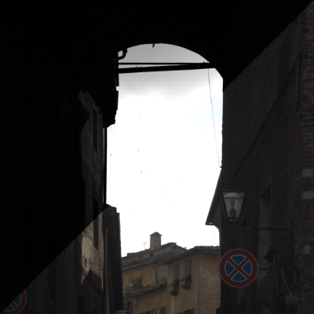
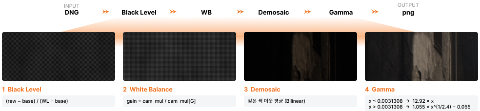
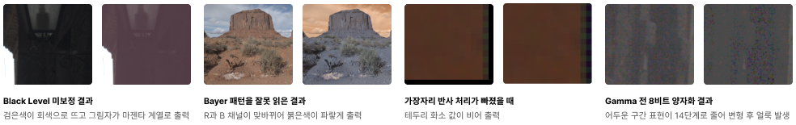
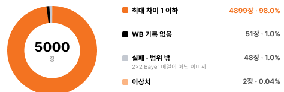
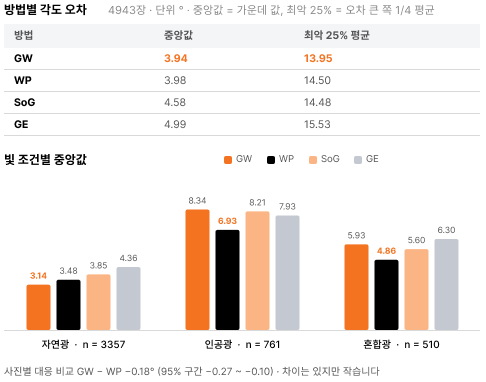

<div align="center">

<br>
<sub>파이프라인 처리 전후 비교</sub>

### Image Signal Processor 파이프라인 구현

> **개발 기간**: 2026. 10<br>
> **형태**: 개인 프로젝트
>
> 카메라 센서의 **RAW(Bayer) 데이터를 sRGB 이미지로 바꾸는 ISP**를 C++로 직접 구현하고<br>
> **LibRaw 기준 결과와 대조**해 MIT-Adobe FiveK 5000장으로 검증한 프로젝트

| 성과 | 내용 |
|:---:|---|
| **파이프라인 구현** | Black Level → White Balance → Demosaic → Gamma 4단계를 수식부터 구현 |
| **FiveK 전수 검증** | 5000장 중 **4899장(98.0%)** 이 LibRaw 결과와 채널별 8비트 최대 차이 1 이하 |
| **AWB 4종 비교** | Gray World · White Patch · Shades of Gray · Gray Edge를 **4943장**에서 각도 오차로 비교 |

</div>

---

## 목차

- [소개](#intro)
- [파이프라인 구성](#pipeline)
- [단계별 실험](#experiments)
- [LibRaw 대조 검증](#validation)
- [AWB 4종 비교](#awb)
- [기술 스택](#tech-stack)
- [실행 방법](#run)

---

<a name="intro"></a>

## 소개

ISP의 각 단계를 라이브러리 함수로 부르는 대신, 수식을 보고 **한 단계씩 직접 구현**하며 이해하기 위한 프로젝트입니다.

- **입력 · 출력**: DNG(RAW) 파일을 LibRaw로 읽어 Bayer 배열과 메타데이터를 꺼내고, 파이프라인을 거쳐 png로 저장
- **검증**: 같은 사진을 LibRaw와 직접 구현한 파이프라인으로 각각 처리해 결과를 비교
- **실험**: 단계의 구조나 입력을 일부러 바꿔 보며, 결과물의 문제가 어느 단계에서 생기는지 확인
- **기록**: 단계마다 구현 과정과 회고를 [`docs/`](docs)에 정리

---

<a name="pipeline"></a>

## 파이프라인 구성



| 단계 | 구현 내용 | 코드 |
|---|---|---|
| **Black Level** | `(raw − black) / (white − black)` 로 정규화 | `src/black_level.cpp` |
| **White Balance** | 카메라 기록값으로 이득 계산 `gain = cam_mul / cam_mul[G]` | `src/white_balance.cpp` |
| **Demosaic** | 같은 색 이웃 화소 평균으로 빈 채널 보간 (Bilinear) | `src/demosaic.cpp` |
| **Gamma** | sRGB 감마 곡선 적용 (선형 구간 12.92 × x, 그 외 1.055 × x^(1/2.4) − 0.055) | `src/gamma.cpp` |

---

<a name="experiments"></a>

## 단계별 실험

각 단계를 빼거나 바꿔서 실행하는 옵션을 두고, 결과물이 어떻게 깨지는지 확인했습니다.



| 실험 | 옵션 | 결과 |
|---|---|---|
| Black Level 미보정 | `--no-black` | 검은색이 회색으로 뜨고 그림자가 마젠타 계열로 출력 |
| Bayer 패턴을 잘못 읽음 | `--swap-rb` | R과 B 채널이 맞바뀌어 붉은색이 파랗게 출력 |
| 가장자리 반사 처리 누락 | — | 테두리 화소 값이 비어 출력 |
| Gamma 전 8비트 양자화 | `--quantize-linear` | 어두운 구간 표현이 14단계로 줄어 변형 후 얼룩 발생 |

---

<a name="validation"></a>

## LibRaw 대조 검증

MIT-Adobe FiveK 5000장을 LibRaw와 직접 구현한 파이프라인으로 각각 처리하고, 채널별 8비트 최대 차이 · 평균 절대 차이 · 16비트 최대 차이를 비교했습니다.



- **4899장(98.0%)** 은 모든 채널에서 8비트 최대 차이 1 이하
- 카메라 WB 기록이 없는 **51장**은 R · B 이득이 0으로 계산되어 초록색 이미지로 출력
- **48장**은 2×2 Bayer 배열이 아니거나 LibRaw 기준 생성에 실패해 비교 범위 밖으로 분류
- 결과 원본: [`experiments/01_isp_validation/`](experiments/01_isp_validation)

---

<a name="awb"></a>

## AWB 4종 비교

WB 기록 없이 이미지 통계만으로 조명을 추정하는 4가지 방법을 구현하고, **카메라 기록 WB 대비 각도 오차**로 비교했습니다.



- 전체 중앙값은 3.94° ~ 4.99°로 비슷했지만, **빛 조건에 따라 가장 좋은 방법이 달라짐**
  - 자연광은 Gray World(3.14°), 인공광 · 혼합광은 White Patch(6.93° · 4.86°)가 가장 작음
- 인공광에서는 네 방법 모두 오차가 자연광의 약 1.8 ~ 2.7배
- 최악 25% 평균은 13.95° ~ 15.53°로 중앙값의 3배 이상이라, 실패 사진은 따로 나눠 원인을 봐야 함
- 결과 원본: [`experiments/02_awb/`](experiments/02_awb)

---

<a name="tech-stack"></a>

## 기술 스택

| 분류 | 기술 |
|---|---|
| **Language** |   |
| **Image** |   |
| **Build · Env** |  -FCC624?style=plastic&logo=linux&logoColor=black) |
| **Analysis** |   |

---

<a name="run"></a>

## 실행 방법

OpenCV와 LibRaw가 설치된 Linux 환경이 필요합니다.

```bash
cmake -S . -B build && cmake --build build
./build/isp <input.dng> [options]
```

| 옵션 | 동작 |
|---|---|
| (없음) | 기본 파이프라인 실행 후 png 저장 |
| `--compare-libraw` | LibRaw 기준 결과와 비교 |
| `--awb <gw\|wp\|sog\|ge>` | 카메라 기록 대신 AWB 추정 이득으로 렌더링 |
| `--awb-eval` | AWB 4종의 각도 오차만 계산해 csv에 기록 |
| `--no-black` · `--swap-rb` · `--quantize-linear` 등 | 단계별 실험 옵션 (`--help`로 전체 확인) |
